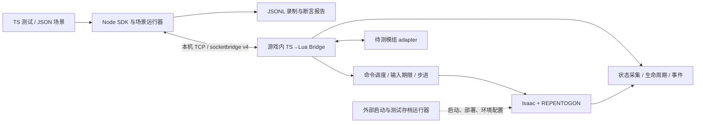

# SocketBridge v4：面向模组逻辑测试的 TypeScript 重构

日期：2026-10-05。本文取代旧 `REFACTORING_PLAN.md` 作为当前开发入口；根目录的资产/视觉测试设计保留为背景记录。

阅读顺序：本文说明设计与机制取舍；[PROTOCOL.md](PROTOCOL.md) 说明可调用接口；[VALIDATION.md](VALIDATION.md) 区分源码实现、离线覆盖和实机证据。

## 1. 目标与范围

核心是一个可观察、可控制、可扩展的游戏运行时测试接口。开发者使用 TypeScript 编写业务和测试，通过结构化日志、事件和实时状态验证模组行为。图片不是必要证据。资产文档的价值在于已经验证了 Launcher 启动链；新桥不依赖资产生成器或图像比较。

v4 同时重建游戏端 TS→Lua 与主机端 Node/TS。Python v3 保留为历史分析工具，不参与新控制链。协议有显式版本，不做可能产生错误状态的隐式 v3 兼容。

本轮实现覆盖：非阻塞通信、握手、请求关联、生命周期、按需快照/订阅、事件录制、有限帧输入、REPENTOGON 暂停/步进、具名游戏命令、模组自定义测试接口、Node SDK/CLI/声明式场景、自动化离线测试。游戏启动和存档隔离仍是独立运行器边界；本桥不会因收到连接自动开新局或改写玩家存档。实机验证与离线测试在最终状态报告中分别列明。

## 2. 需要纠正的旧实现

| 问题 | v4 约定 |
|---|---|
| pcall 成功被当作 connect/send 成功；partial 丢失 | 检查全部返回值，RX buffer 与 TX 游标持久化 |
| 主机 Hub 按 FIFO 匹配命令 | requestId 从主机到 Lua 再到结果完整保留 |
| 断线后输入残留 | 输入期限 + 心跳租约 + 断线/切局释放 |
| 表示“没有实体”和“未收到数据”混淆 | sensor `ok/error/unsupported`，`ok + []` 明确清空 |
| 用 Index/TTL 猜实体生命周期 | 会话内实体引用、房间/局 epoch；完整快照替换 |
| 房间标识仅 room index | stage/stageType/dimension/descriptor + roomEpoch |
| 库存扫描到 733 | 使用引擎 ItemConfig 大小及真实 GetCollectibleNum，支持 mod 道具 |
| enemies 只保留 vulnerable | 采集 NPC，并把 active/vulnerable/friendly 等状态作为字段 |
| Type 6 当 NPC | slot 独立采集，不调用 ToNPC 推测槽机机制 |
| projectile/tear 与阵营混合 | 按引擎实体类型区分，记录 spawner/parent，不按玩家发射推断所有阵营 |
| black_hearts 被当作普通心数量 | 明确黑心位掩码；红/魂心半心单位与骨/腐/碎心字段分开 |
| tears 字段实际是 MaxFireDelay | 使用准确 API 字段名，不把 fire delay 称作射速 |
| damage callback 中的 hp_after | 使用 REPENTOGON post damage，仍标注 callback 阶段，随后快照验证 |
| 事件/命令没有统一时序 | 每连接 seq、runEpoch、roomEpoch、updateTick、renderTick |
| 通道 mirror、缓存、实体 store 多处维护状态 | 一个权威快照格式；主机只保留 epoch 匹配的最新 sensor 值 |

## 3. 模块结构

```text
src/protocol/     无 Node/Lua 运行时依赖的消息类型、命令校验
src/runtime/      TS→Lua：连接、输入、调度、传感器、引擎适配、回调
src/host/         Node：连接服务器、SDK、状态、录制、场景与 CLI
tests/           Node 网络集成 + 编译后 Lua/Fengari 行为测试
tools/           构建、生成配置、部署产物
examples/        场景及测试接口示例
mod/             构建产物（不手工编辑）
legacy/          v3 Lua 快照；python/ 保留旧工具
```

游戏端借用优化模板的 Lua 5.3、枚举内联、require-minimal、独立入口和隐藏 self 经验。主机/游戏使用不同 tsconfig。协议类型可以共享；Node 包不能进入 Lua bundle。实际需要的 lualib helper 可以保留，以测试和体积记录约束，不以“零 helper”为功能前提。



三份旧成果的职责因此分开：资产探针提供已验证的启动方法及环境发现；优化模板提供构建策略；旧 SocketBridge 提供行为需求和反例。旧 socket/缓存实现不继续包一层沿用。

## 4. 协议与连接

UTF-8 JSON Lines，主机监听 loopback，游戏主动连接。配置包含 port 和 token；主机发送 welcome 才开始会话。错误 token、版本、旧连接、非单调 seq、超限消息均拒绝。一个主机只允许一个活动游戏连接，不能被后来的未认证连接抢占。

统一字段：`protocol/sessionId/connectionId/seq/runEpoch/roomEpoch/updateTick/renderTick/kind/payload`；命令和结果另有 `requestId`。结果区分 accepted/completed/failed/cancelled。主机超时只表示未确认，绝不自动重放有副作用的命令。

游戏端限制每帧读写字节、消息大小、队列容量。控制事件不能静默丢弃；背压超限则断开并释放控制，主机收到明确失败。低频 heartbeat 独立于 sensor 订阅；无订阅不采集全部世界。

同连接 requestId 重复返回缓存终态或保持 accepted；参数不同拒绝；缓存达到上限后不能无声遗忘并重新执行。重连会生成新 session，旧请求记为未知，不提供跨重连 exactly-once 承诺。

## 5. 回调阶段与 REPENTOGON

官方回调依据：<https://repentogon.com/enums/ModCallbacks.html>，并核对本机 `Repentogon/resources/scripts/enums_ex.lua`。

- `MC_PRE_UPDATE`（1026）：在主要更新前调用，返回 true 可取消本次更新。v4 用于控制暂停/步进和命令的世界修改阶段；步数在实际 `MC_POST_UPDATE` 才扣减，防止其他 mod 取消更新导致虚假进度。
- `MC_POST_ENTITY_TAKE_DMG`（1006）：记录 entity/damage/flags/source/countdown，ExtraSource 按可选字段处理；事件不更改引擎返回值。
- `MC_POST_ADD_COLLECTIBLE`（1005）：明确是添加收藏品事件，不自动声称发生了自然拾取。
- `MC_POST_USE_ITEM`（1003）：记录实际使用之后的事件，不用 MC_USE_ITEM 抢占业务返回值。
- `MC_MAIN_MENU_RENDER`（1023）及正常 render：网络维护，不在菜单中调用依赖玩家/房间的 API。

能力由实际 callback/API 存在性报告，缺失时返回 unsupported。API 存在与实机语义已验证不同；文档与测试报告保留该区分。暂停是桥主动取消更新，不等于所有 UI/render 动画冻结；`step` 不承诺跨版本确定性模拟。

启动有三个独立门槛，不能合并成一个“connected”：

| 门槛 | 实现依据 | 可以开始的工作 |
|---|---|---|
| 通信就绪 | hello/welcome/ready 完成，`waitReady()` 返回 | 查询身份、能力，配置订阅，清理桥控制 |
| 游戏局面就绪 | `MC_POST_GAME_STARTED` 后 `inGame=true` | 快照、输入、世界修改与更新步进 |
| 待测模组就绪 | adapter 已注册且 `ready()` 为 true | 该模组的观察、fixture 和业务断言 |

本机 REPENTOGON 1.1.3 已实测：main.lua 在进入局面前执行，`MC_MAIN_MENU_RENDER` 能维持菜单通信；`runtime.describe` 返回 `phase=outside-run`。这不证明任意模组在菜单已经完成业务初始化。待测模组可能直到入局、读取存档、生成房间后才就绪，应自己实现 `ready()`，不能由桥根据固定延时猜测。

adapter 可以在 `MC_POST_MODS_LOADED` 后注册，或由待测模组在确认全局 API 存在时延迟注册。它的初始化标志由业务本身维护，观察函数不能触发初始化。未实现 `ready()` 的 adapter 约定为注册即就绪。宿主的 `waitForRuntime()` 请求新鲜身份数据，分别检查 `inGame`、`adapters`、`adapterReadiness`；场景 `requires` 声明这些前置条件。超时或换会话直接失败。SDK 的 `runScenario()` 要求调用方先建立连接；CLI 已完成这一阶段。

退出游戏时清理输入、暂停、待执行命令与实体引用，推进 roomEpoch，使宿主旧快照失效。进入新局增加 runEpoch、重置 updateTick；普通切房只推进 roomEpoch。原生暂停、焦点暂停和其他模组取消 update 都可能阻止实际更新；墙钟期限依然生效。缺少菜单回调时不保证局前连接，但入局 render 仍可维护网络；缺少 PRE_UPDATE 时拒绝世界命令及步进，不提供偷偷降级的假成功。

所有世界修改通过调度器；未入局或原生暂停导致无法更新时用墙钟超时。resume/输入清理等控制操作可以在 render 泵处理，避免“已暂停却再也收不到恢复命令”。断线立即撤销桥的暂停和输入，原生 pause 状态不强行修改。

## 6. 数据模型

首版 sensors：`players`（位置/属性/心量）、`inventory`、`room`、`grid`、`entities`，并支持按 entities 类型筛选的 `npcs/pickups/projectiles/tears/lasers/bombs/familiars/slots/effects`。同次采样共享一次房间实体枚举；按需选择 scope，避免每帧遍历库存和地形。

sensor 结果带 status、sample tick、完整数据或错误。集合完整替换，没有变化的哈希优化留待测量；不依赖 TTL 判断消失。未知值不伪造为零。实体包含位置、速度、type/variant/subtype、InitSeed/Index、稳定 session 引用和 Sprite 动画/帧等可选观测。房间切换使旧引用失效。

库存覆盖 ItemConfig 实际范围，并显式说明程序给予道具与自然拾取的不同。buff/临时效果/隐藏道具不能假设都体现在库存数量；通过 `mod.observe` 或新增引擎适配器提供相应数据。心量保持 API 原始语义，复杂角色有效生命判断由场景或专门适配器负责。

大整数 flags 编码为字符串；空数组明确为 `[]`，空对象为 `{}`。不得把 Lua userdata、循环表、函数或非有限数字直接序列化到 wire。

## 7. 命令与测试接口

只读：`runtime.describe/state.snapshot/telemetry.subscribe/item.resolve/mod.observe`。

控制：`runtime.pause/runtime.resume/runtime.step/input.pulse/input.clear`。

修改：`entity.spawn/entity.remove/player.giveCollectible/player.removeCollectible/mod.invoke`。原始 `console.execute` 仅在配置显式启用时提供。

所有命令验证参数和运行状态；有限动作有 deadline。输入区分 pressed/triggered/value；triggered 在脉冲首个实际更新有效，同帧重复查询一致。输入按 playerIndex 指定，不自动接管所有玩家。

通过全局 `SocketBridgeV4` 注册 mod adapter，提供命名的 observe/invoke 方法，返回 JSON 可序列化数据；接口只在开发构建启用。不暴露 eval/任意代码。观察字段可以是状态机阶段、内部计数、缓存 key、伤害倍率来源等，避免为了测试反向猜测全部业务细节。

测试用例以 setup/action/assert/cleanup 组织。可检查快照字段、事件出现、状态变化、一定更新步内满足条件；每个等待另有墙钟期限。SDK 返回已关联的命令终态。CLI 使用结构化场景；失败退出码不受 JSON 输出选项影响。

## 8. 日志与可追溯性

主机记录双向原始消息、连接生命周期、命令结果和错误至 JSONL；每次录制独立 session。机器 stdout 与进度 stderr 分开。游戏启动/socket 不可用时输出带 `[SocketBridgeV4]` 标记的诊断；不每帧 print 原始数据。

事件保留 callback 阶段，不把 NPC 死亡、移除、拾取物碰撞、道具添加合并成一个推测事件。存在性与行为期望以新鲜快照和 mod adapter 补强。严格测试遇到丢事件、断线、未知 sensor 或超时不得通过。

## 9. 构建、安装与旧版迁移

构建产出 `mod/main.lua`、metadata、build manifest。源码 `main.lua` 迁入 legacy 后，仓库根入口只给出构建/安装提示，防止误用旧版。旧 Python 不兼容 v4，保留历史 README 说明。

部署前确认游戏已退出，备份既有 SocketBridge 目录的明确文件清单，再复制完整 v4 artifact。不修改其他 mod、存档、Steam 或显示配置。主机 `serve` 等待游戏连接；自动化 Launcher 由后续独立运行器接入，不能把不完整的存档恢复复制进通信桥。

安装备份在游戏根目录 `.socketbridge-deploy-backups/<id>/previous/`，与目标同卷；从其他盘运行源码也不依赖跨卷 rename。原安装整目录保留，包括用户新增文件。恢复旧备份前检查当前安装是否匹配已记录的构建及文件哈希，被撤下的 v4 也保留。部署脚本不是多进程事务服务：不要同时部署/恢复，进程被强杀后的 journal 仍需人工判读。

启动诊断必须写入 `Isaac.DebugString`，单独 print 不足以在本机日志定位加载失败。2026-10-05 实测推翻了原资产文档的一项推测：**自带 LuaSocket DLL 不等于默认可 require；本机 `LuaDebug=0` 失败，显式 `--luadebug` 成功。** v4 不动态下载 DLL 或修改 Lua 的全局搜索规则来掩盖启动问题。

跳过片头采用 REPENTOGON 正式配置 `[VanillaTweaks] SkipIntro=1`，位置是文档目录下的 `Binding of Isaac Repentance+/Repentogon/options.ini`。这不等于选择存档或开始游戏。`tools/menu-smoke.mjs` 只实现菜单连通性验收；完整 fixture 启动、测试存档隔离和崩溃恢复仍属下一阶段运行器。

## 10. 验收

离线门槛：TS 类型检查、TSTL 构建、host 真实 loopback 测试（握手/多包/断线/超时）、编译 Lua 的网络 partial/输入/步进/快照测试、错误场景和退出码测试、协议非法输入测试。

实机门槛：REPENTOGON 下 HELLO、暂停/步进精确 tick、物品 ID 超过 733、自然拾取与程序添加差别、不可受伤 NPC、实体清空/重入房间、输入断线释放、mod adapter、重复会话与耗时。未执行的项目明确记为未验证，不能由 Fengari 测试替代。

实施顺序：先协议和构建 → 网络/SDK → scheduler/input → engine sensors/commands → callbacks/adapter → 场景与录制 → 离线回归 → 可行的实机检查。视觉捕获不在关键路径。

## 11. 如何验证模组逻辑

一次可解释的用例应声明 fixture、行为触发、可观测结果和清理。例如“道具 A 在玩家受伤后生成一个友方实体”：先等待业务就绪，记录玩家/实体基线；通过真实游戏行为或受控 fixture 造成伤害；观察 post damage 事件，推进有限更新，检查目标实体数量、类型、状态和 mod 内部计数。不能只断言 `entity.spawn` 命令成功，因为那绕过了待测业务；也不能用“道具添加”事件声称玩家完成了自然拾取。

原生传感器提供外部效果，adapter 提供解释效果所需的内部状态，两者交叉验证。adapter 的 `invoke` 仅用于已命名的 fixture 操作，不能把预期结果直接写入内部计数来替代测试。缓存中的快照只用于观察展示，严格断言使用新鲜 `snapshot()`。

| 测试种类 | 合适的证据 | 需要控制的变量 |
|---|---|---|
| 被动道具属性计算 | 属性快照 + mod 倍率/缓存原因 | 角色、已有道具、临时效果、更新阶段 |
| 伤害/死亡触发 | post damage / npc.died / entity.removed + 后续快照 | 无敌状态、伤害源、伤害 flags、友好实体 |
| 主动道具与输入 | input.pulse + item.used + 充能/状态变化 | 玩家索引、输入 hook、原生暂停、槽位 |
| 房间/楼层逻辑 | epoch + 完整房间快照 + mod 状态机 | seed、dimension、重进房间、continue/new run |
| 实体生成/移除 | 引用与 type/variant/subtype + 完整集合变化 | 指针复用、生命周期、跨房实体 |
| 长期回归 | 固定 fixture 的 JSONL 与断言报告 | 游戏/RGON/mod 构建、其他启用模组、设置 |

当前事件集合只是第一批观测点，不是全引擎事件镜像。没有广泛拦截所有 Lua 日志或替其他模组改写回调；业务通过 `SocketBridgeV4.emit()` 发结构化事件。渲染异常若无法由 Sprite 动画/帧、位置和业务状态解释，才增加可选图像证据。

## 12. 后续实施顺序与限制

本轮已经重建桥、SDK、场景运行器和构建部署，局内能力仍必须过真实引擎验收。后续优先级如下：

1. 独立测试存档与可恢复运行器：记录有效存档路径、Steam Cloud/REPENTOGON 附加状态、启用 mod 清单、进程身份，失败保留现场；不要用“复制一个 dat 文件”冒充完整隔离。
2. 建立最小待测 fixture mod，逐项跑暂停/步进、按玩家输入、自然拾取、post damage、切房/continue、断线释放与 ready 状态。先验证机制，再扩展业务场景。
3. 扩展 sensor/command 的机制覆盖：复杂角色心量、临时效果来源、饰品效果、特殊输入玩家、REPENTOGON 槽机/网格扩展等，均配语义说明和实机反例。
4. 性能与耐久：记录采样耗时、单帧事件峰值、长时间实体引用数量、字节/队列水位。当前只有限额和按需采集，尚无覆盖复杂房间的耗时基准；也没有跨会话重放确定性承诺。

暂不包含：自动通关 AI、完整的 v3 Python 兼容层、图像生成链、任意脚本执行、批量多实例桌面调度、外部 CI 无图形环境下的游戏仿真。它们不能替代最先需要的可靠逻辑观测与控制基础。
